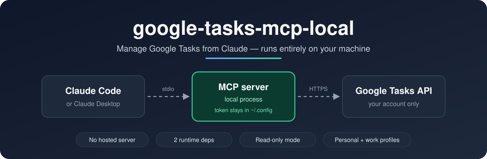
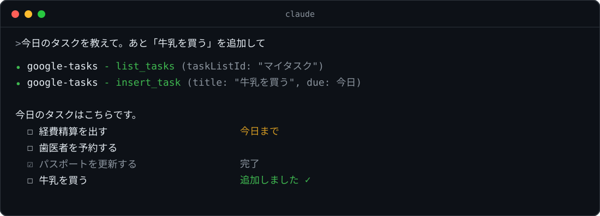

<p align="center">
  
</p>

<p align="center">
  <a href="README.md">English</a> · <b>日本語</b>
</p>

# google-tasks-mcp-local

Claude Code / Claude Desktop から Google Tasks を読み書きするための MCP サーバーです。自分のマシンの中だけで動きます。

外部サーバーは使わず、通信するのは自分のマシンと Google Tasks API だけです。OAuth クライアントも自分のものを使います。保存するのはトークンだけで（`~/.config/google-tasks-mcp-local/`、0600）、タスクの中身は保存しません。

依存は `@modelcontextprotocol/sdk` と `zod` の 2 つだけと小さいので、情シスの審査にも出しやすいです。個人用と会社用のプロファイルを分けて使え、読み取り専用モードもあります。

<p align="center">
  
</p>

## はじめかた

Node.js 20 以上が必要です。

```sh
git clone https://github.com/mzkii/google-tasks-mcp-local
cd google-tasks-mcp-local
npm install
npm run setup
```

`npm run setup` が最後まで順に案内します。

1. OAuth クライアントを作るために、Google Cloud Console を開いて手順を表示します（5 分ほど。下に詳しく書いています）。JSON をダウンロードすると、`~/Downloads` から自動で読み込みます
2. 認可のためにブラウザが開くので、ログインして許可します
3. `Y` と答えると `claude mcp add` を実行して登録します（Claude Desktop 用の設定も表示します）

Claude Code を再起動し、「Google Tasks のリストを見せて」「買い物リストに牛乳を追加して」のように話しかけてください。

### OAuth クライアントの作り方（Google Cloud Console）

1. 新しいプロジェクトを作る
2. [Google Tasks API](https://console.cloud.google.com/apis/library/tasks.googleapis.com) を有効にする
3. 「Google Auth Platform」→「開始」。アプリ名とメールを入力し、対象は「外部」を選ぶ
4. 「対象」→「アプリを公開」（テストのままだと **7 日で認可が切れる**）。公開するには、アプリ名に「Google」を含めないことと、ホームページとプライバシーポリシーの URL（GitHub Pages などに自分で用意したページ。[このリポジトリの `docs/`](docs/) が例）が必要
5. [クライアント → クライアントを作成](https://console.cloud.google.com/auth/clients) → 種類「デスクトップアプリ」→ JSON をダウンロード

認可するときに「このアプリは Google で確認されていません」と表示されます。自分のクライアントなので、「詳細」→「（アプリ名）（安全ではないページ）に移動」で進めてください。

> 会社の Google Workspace アカウントで使う場合は、会社の GCP に、対象を「内部」にしたクライアントを作ってもらいます。内部なら公開は不要で、警告も出ません。会社の GCP を使ってよいかは、事前に社内で確認してください。

## 会社用・読み取り専用

プロファイルを分けると、個人用と会社用を並べて使えます。`npm run` に引数を渡すときは `--` を挟みます。

```sh
npm run setup -- --profile work                # google-tasks-work として登録
npm run setup -- --profile work --readonly     # 一覧・取得だけ
npm run setup -- ~/path/to/client_secret.json  # JSON を指定する
```

## 自動実行で使うとき

定期実行のジョブが Slack のメッセージのような信頼できないテキストを読むと、そのテキストに AI が誘導されるおそれがあります。ジョブに必要なツールとリストだけを登録しておけば、乗っ取られたときの被害を小さくできます。リスト ID は `list_task_lists` が返す `id` です。

```sh
claude mcp add google-tasks-side -s user -e GOOGLE_TASKS_TOOLS=list_tasks,insert_task,patch_task -e GOOGLE_TASKS_ALLOWED_LISTS=<list id> -- node /path/to/build/index.js
```

Claude Desktop では次のように設定します。

```json
{
  "mcpServers": {
    "google-tasks-side": {
      "command": "node",
      "args": ["/path/to/build/index.js"],
      "env": {
        "GOOGLE_TASKS_TOOLS": "list_tasks,insert_task,patch_task",
        "GOOGLE_TASKS_ALLOWED_LISTS": "<list id>"
      }
    }
  }
}
```

### Slack から Google Tasks への同期

`automation/` に、直近の Slack のメンション、DM、スレッドの更新から自分宛てのアクションアイテムを拾ってタスクリストに追加する、macOS 向けの汎用ジョブがあります。Claude Code CLI にログイン済みで、claude.ai の Slack コネクタを Claude Code で認可済み（`/mcp` から認可）、このサーバーを `npm run setup` で設定済みであることが前提です。

`automation/config.example.env` をこのリポジトリの外の自分だけの場所にコピーし、タスクリスト ID とスケジュールを書き込んでから、インストールして一度実行します。

```sh
bash automation/install.sh /path/to/your/config.env
launchctl kickstart gui/$(id -u)/local.google-tasks-mcp.slack-sync
tail -f ~/Library/Logs/google-tasks-mcp-local/slack-sync.log
```

`install.sh` は設定を `~/.config/google-tasks-mcp-local/automation/` にコピーして launchd のジョブを登録するので、設定ファイルの置き場所にジョブは依存しません。`install.sh --uninstall` でジョブを削除できます（コピーした設定は残ります）。リポジトリは `~/Documents`、`~/Desktop`、`~/Downloads` の外に置いてください。macOS はこれらのフォルダを launchd のジョブから読ませないので、`Operation not permitted` で失敗します。

Slack のテキストは信頼できないものとして扱います。ヘッドレス実行で許可するのは、設定に書いた読み取り専用の Slack ツールと、1 つのタスクリストに対する `list_tasks`、`insert_task`、`patch_task` だけで、それ以外は `--permission-mode dontAsk` がすべて拒否します。実行のたびに Claude のサブスクリプションの使用量を消費します。

## 困ったとき

| 症状 | 対処 |
| --- | --- |
| Claude から「認可が必要です」と返ってくる | `npm run auth`（会社用は `npm run auth -- --profile work`） |
| `401 invalid_client` / `The OAuth client was not found` | クライアントを作った直後なら数分待つ。または JSON が古いか削除済み |
| `redirect_uri_mismatch` | 種類が「ウェブアプリ」になっている。「デスクトップアプリ」で作り直す |
| `access_denied` / 403 | アプリを公開していない（テスト中ならテストユーザーに追加する）、または組織のポリシーでブロックされている |
| 7 日ごとに認可が切れる | アプリを公開してから `npm run auth` を実行する |

## やめるとき

```sh
claude mcp remove google-tasks -s user
rm -rf ~/.config/google-tasks-mcp-local
```

最後に、Google アカウントの [サードパーティ製のアプリとサービス](https://myaccount.google.com/permissions) からアクセスを削除します。

## しくみ

```
Claude Code ──stdio──▶ google-tasks-mcp-local（ローカルのプロセス）──HTTPS──▶ Google Tasks API
                              │
                              └ ~/.config/google-tasks-mcp-local/<profile>/
                                   credentials.json  OAuth クライアント（0600）
                                   token.json        トークン（0600）
```

認可は `127.0.0.1` で一時的に待ち受けるループバック OAuth です。PKCE と state で検証し、アクセストークンは自動で更新されます。スコープは `https://www.googleapis.com/auth/tasks` です。`--readonly` を付けると `tasks.readonly` になります。

ログは stderr にだけ出力し、トークンは出力しません。

<details>
<summary>コマンド・環境変数・ツール一覧</summary>

| コマンド | 説明 |
| --- | --- |
| `npm run setup -- [JSON] [--profile 名前] [--readonly]` | JSON を配置し、認可して、登録する |
| `npm run auth -- [--profile 名前] [--readonly]` | 認可し直す |
| `node build/index.js` | MCP サーバーとして起動する（通常は Claude が自動で起動する） |

| 環境変数 | 既定値 | 説明 |
| --- | --- | --- |
| `GOOGLE_TASKS_PROFILE` | `default` | プロファイル名。`--profile` が優先される |
| `GOOGLE_TASKS_READONLY` | 未設定 | `1` にすると、読み取り系の 4 ツールだけを登録する |
| `GOOGLE_TASKS_TOOLS` | 未設定 | 登録するツール名をカンマ区切りで指定する（例: `list_tasks,insert_task`）。未知の名前はエラー |
| `GOOGLE_TASKS_ALLOWED_LISTS` | 未設定 | 許可するタスクリスト ID をカンマ区切りで指定する。それ以外のリストは拒否し、リストの新規作成も無効になり、`list_task_lists` もこれらだけを返す |
| `XDG_CONFIG_HOME` | `~/.config` | 保存先の基点 |
| `LOG_LEVEL` | `info` | `debug` / `info` / `warn` / `error` |

ツール: `list_task_lists`, `get_task_list`, `insert_task_list`, `update_task_list`, `patch_task_list`, `delete_task_list`, `list_tasks`, `get_task`, `insert_task`, `update_task`, `patch_task`, `delete_task`, `clear_completed_tasks`, `move_task`（読み取り専用では `list_` / `get_` の 4 つだけ）

</details>

## ライセンス

MIT。[akutishevsky/google-tasks-mcp](https://github.com/akutishevsky/google-tasks-mcp) をフォークしたものです。

役に立ったらスターをもらえると、ほかの人にも見つけてもらいやすくなります。
