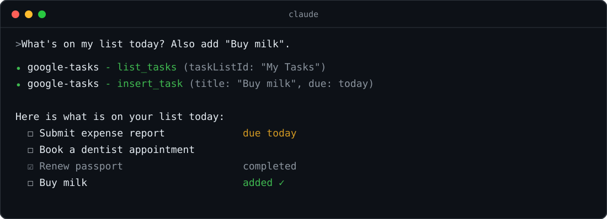

<p align="center">
  
</p>

<p align="center">
  <b>English</b> · <a href="README.ja.md">日本語</a>
</p>

# google-tasks-mcp-local

An MCP server that lets **Claude Code** and **Claude Desktop** read and manage your **Google Tasks** — running entirely on your own machine.

- 🔒 **No hosted server.** Traffic goes only between your machine and the Google Tasks API
- 🗝️ **Your own OAuth client.** Only the token is stored (`~/.config/google-tasks-mcp-local/`, mode 0600). Task contents are never saved
- 🪶 **Tiny.** Two runtime dependencies (`@modelcontextprotocol/sdk`, `zod`) — easy to audit before your IT team approves it
- 👥 **Personal + work profiles**, and a **read-only mode**

<p align="center">
  
</p>

## Quick start

Requires Node.js 20+.

```sh
git clone https://github.com/mzkii/google-tasks-mcp-local
cd google-tasks-mcp-local
npm install
npm run setup
```

`npm run setup` walks you through everything:

1. **Create an OAuth client** — it opens Google Cloud Console and shows the steps (≈5 min, see below). When you download the JSON, setup picks it up from `~/Downloads` automatically
2. **Authorize** — a browser opens; sign in and allow access
3. **Register** — answer `Y` and it runs `claude mcp add` for you (the Claude Desktop config snippet is printed too)

Restart Claude Code and try: *"Show my Google Tasks lists"* or *"Add 'Buy milk' to my groceries list"*.

### Creating the OAuth client (Google Cloud Console)

1. Create a new project
2. Enable the [**Google Tasks API**](https://console.cloud.google.com/apis/library/tasks.googleapis.com)
3. **Google Auth Platform → Get started**: enter an app name and email, choose audience **External**
4. **Audience → Publish app** — otherwise the authorization expires every 7 days. Publishing requires:
   - an app name that does **not** contain "Google"
   - a homepage URL and a privacy policy URL (any pages you control — e.g. GitHub Pages; [this repo's `docs/`](docs/) is an example)
5. [**Clients → Create client**](https://console.cloud.google.com/auth/clients) → type **Desktop app** → download the JSON

When you authorize, Google shows *"Google hasn't verified this app"*. Since it is your own client, click **Advanced → Go to (app name) (unsafe)**.

> **Using a Google Workspace (work) account?** Ask your admin to create the client in your company's GCP with audience **Internal**. Internal apps need no publishing and show no warning.

## Work account / read-only

Profiles let you use personal and work accounts side by side. Pass arguments after `--`.

```sh
npm run setup -- --profile work                # registered as "google-tasks-work"
npm run setup -- --profile work --readonly     # list/get tools only
npm run setup -- ~/path/to/client_secret.json  # use a specific JSON
```

## Troubleshooting

| Symptom | Fix |
| --- | --- |
| Claude says authorization is required | `npm run auth` (work: `npm run auth -- --profile work`) |
| `401 invalid_client` / `The OAuth client was not found` | Wait a few minutes after creating the client, or the JSON is stale/deleted |
| `redirect_uri_mismatch` | The client type is "Web application". Recreate it as **Desktop app** |
| `access_denied` / 403 | App not published (add yourself as a test user), or blocked by org policy |
| Authorization expires every 7 days | Publish the app, then run `npm run auth` |

## Uninstall

```sh
claude mcp remove google-tasks -s user
rm -rf ~/.config/google-tasks-mcp-local
```

Then remove access at [Google Account → Third-party apps & services](https://myaccount.google.com/permissions).

## How it works

```
Claude Code ──stdio──▶ google-tasks-mcp-local (local process) ──HTTPS──▶ Google Tasks API
                              │
                              └ ~/.config/google-tasks-mcp-local/<profile>/
                                   credentials.json  OAuth client (0600)
                                   token.json        token (0600)
```

- Loopback OAuth on `127.0.0.1` with PKCE and state verification. Access tokens refresh automatically
- Scope: `https://www.googleapis.com/auth/tasks` (`tasks.readonly` with `--readonly`)
- Logs go to stderr only; tokens are never logged

<details>
<summary>Commands, environment variables, tools</summary>

| Command | Description |
| --- | --- |
| `npm run setup -- [JSON] [--profile NAME] [--readonly]` | Install the client JSON, authorize, register |
| `npm run auth -- [--profile NAME] [--readonly]` | Re-authorize |
| `node build/index.js` | Start as an MCP server (Claude starts it for you) |

| Variable | Default | Description |
| --- | --- | --- |
| `GOOGLE_TASKS_PROFILE` | `default` | Profile name (`--profile` takes precedence) |
| `GOOGLE_TASKS_READONLY` | unset | `1` registers only the 4 read tools |
| `XDG_CONFIG_HOME` | `~/.config` | Base directory for storage |
| `LOG_LEVEL` | `info` | `debug` / `info` / `warn` / `error` |

Tools: `list_task_lists`, `get_task_list`, `insert_task_list`, `update_task_list`, `patch_task_list`, `delete_task_list`, `list_tasks`, `get_task`, `insert_task`, `update_task`, `patch_task`, `delete_task`, `clear_completed_tasks`, `move_task` (read-only mode: the 4 `list_` / `get_` tools)

</details>

## License

MIT. Forked from [akutishevsky/google-tasks-mcp](https://github.com/akutishevsky/google-tasks-mcp).

If this is useful to you, a ⭐ helps others find it.
